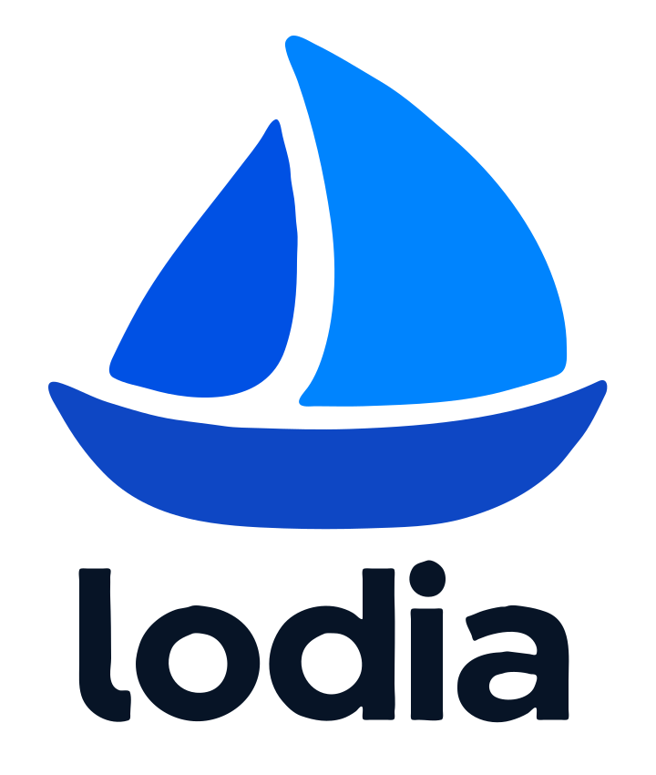

  <picture>
    <source media="(prefers-color-scheme: dark)" srcset="lodia-logo-white.svg">
    
  </picture>

Lodia runs Kubernetes control planes as pods on a management cluster, one per tenant cluster, and lets worker nodes anywhere join them with `kubeadm`.
Each control plane is described by one `ControlPlane` object and runs as ordinary Deployments, with an etcd of its own or a prefix in a shared one.

Phase 1 of the [roadmap](https://github.com/lodia-io/lodia/blob/main/docs/roadmap.md) is done and phase 2 is under way; there is no release yet.

- [What Lodia is](https://github.com/lodia-io/lodia/blob/main/docs/README.md) and [why it is built this way](https://github.com/lodia-io/lodia/tree/main/docs/decisions)
- [Contributing](https://github.com/lodia-io/lodia/blob/main/CONTRIBUTING.md), [security policy](https://github.com/lodia-io/lodia/blob/main/SECURITY.md), [code of conduct](https://github.com/lodia-io/lodia/blob/main/CODE_OF_CONDUCT.md)
- hello@lodia.io
